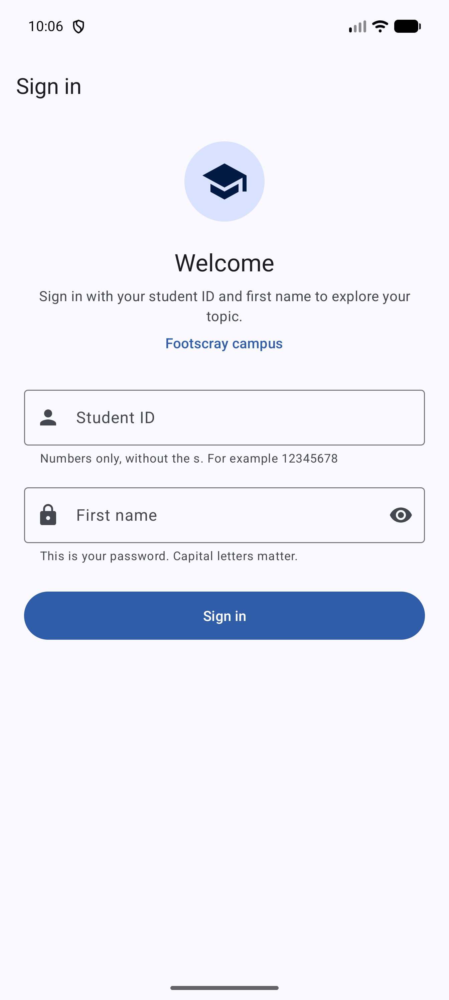
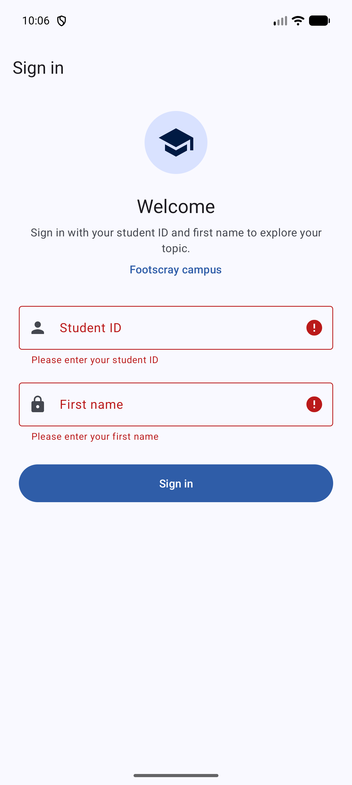
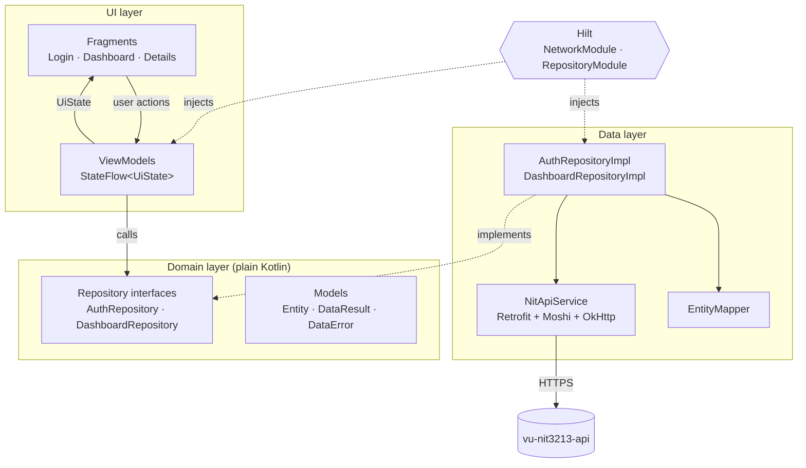
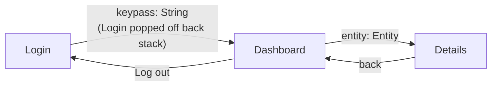
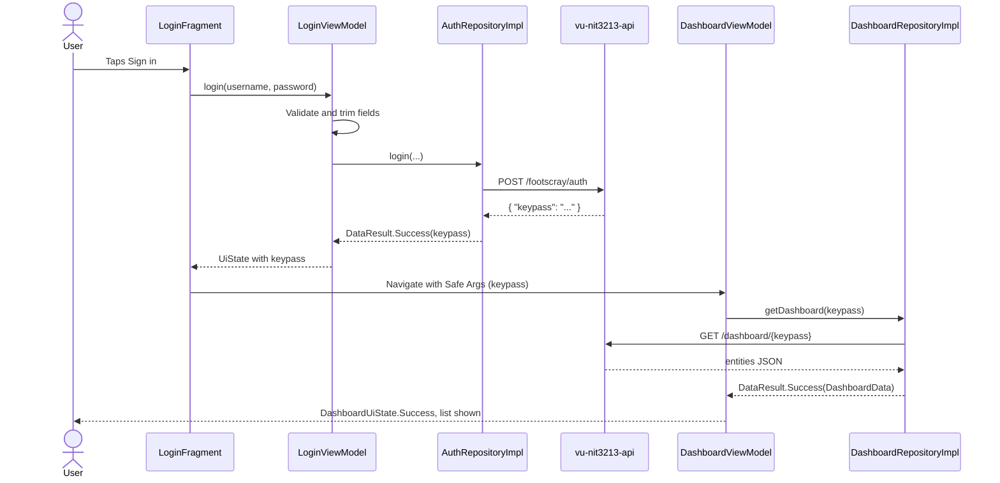

# Topic Explorer

NIT3213 Mobile Application Development, Final Assignment (Footscray campus).

Topic Explorer is an Android app that signs in to the `vu-nit3213-api`, then lists the entities for the student's topic and shows the full details of any entity the user taps. It is written in Kotlin using XML Views, and follows the architecture taught in the unit: a single Activity with Fragments and the Navigation component, ViewModels with StateFlow, Retrofit for networking, and Hilt for dependency injection.

## Features

| Screen | What it does |
| --- | --- |
| **Login** | Student ID (username) and first name (password) fields. Checks both fields before sending anything, then makes a `POST` request to `/footscray/auth`. Shows clear messages for wrong credentials, no internet, timeouts and server errors. On success it moves to the Dashboard and removes Login from the back stack. |
| **Dashboard** | Uses the `keypass` from the login response to call `GET /dashboard/{keypass}`. Shows the entities in a `RecyclerView`, each as a card summarising every field except the description. Includes loading, empty and error states, a "Try again" button and a "Log out" option in the toolbar. |
| **Details** | Shows every field of the selected entity plus its full description, laid out in cards. The toolbar's back arrow returns to the list. |

Other points:

- **Works with any topic.** Each topic returns different field names, so the app reads entities generically and turns field names into readable labels (for example `artistName` becomes "Artist name"). Nothing about a particular topic is hard-coded.
- **Light and dark mode** using a custom Material 3 colour scheme.
- **Handles rotation** without reloading, because state lives in the ViewModels.

## Screenshots

| Login | Login validation |
| --- | --- |
|  |  |

## Requirements

- **Android Studio** Ladybug (2024.2) or newer
- **JDK 17 or 21** for Gradle (Android Studio's built-in JDK normally works; see Troubleshooting)
- **Android SDK Platform 35** (Android Studio offers to install it during the first sync)
- An emulator or phone running **Android 8.0 (API 26) or newer**, with internet access

## Build and run

1. Clone the repository:
   ```bash
   git clone <repository-url>
   ```
2. In Android Studio choose **File > Open** and select the cloned folder.
3. Wait for the Gradle sync to finish. Accept any prompt to install missing SDK components.
4. Pick an emulator or connected device and press **Run** (the green triangle).

From the command line instead:

```bash
./gradlew assembleDebug     # builds app/build/outputs/apk/debug/app-debug.apk
./gradlew installDebug      # installs it on a running emulator or connected phone
```

On Windows, use `gradlew.bat` in place of `./gradlew`.

### Signing in

| Field | What to enter | Example |
| --- | --- | --- |
| Username | Your student ID, numbers only, **without** the `s` | `12345678` |
| Password | Your first name. It's case sensitive, so match the capital letters | `Adam` |

The API is hosted on Render's free tier, which puts the server to sleep when nobody is using it. **The first sign in can take up to a minute** while it wakes up. The app waits for 60 seconds; if it still times out, tap Sign in again.

## Running the unit tests

The tests are local JVM tests, so no emulator is needed.

- **Android Studio:** right-click `app/src/test/java` and choose **Run 'Tests in ...'**
- **Command line:** `./gradlew testDebugUnitTest`

The HTML report is written to `app/build/reports/tests/testDebugUnitTest/index.html`.

| Test class | What it checks |
| --- | --- |
| `LoginViewModelTest` | Form validation, trimming of input, loading state, success, each error message, ignoring double taps, one-off navigation |
| `DashboardViewModelTest` | Loading the list with the keypass from navigation, empty lists, API errors, missing keypass, "Try again" |
| `AuthRepositoryImplTest` | Correct campus URL and request body, and mapping of 400, 401, 500, timeouts and no internet to the right error |
| `DashboardRepositoryImplTest` | Mapping the raw JSON into entities, 404 handling, no internet, unexpected exceptions |
| `EntityMapperTest` | Separating the description, keeping field order, readable labels, number, list and nested object formatting |

Tests use **JUnit 4**, **MockK** to replace the repositories and API with mocks, and **kotlinx-coroutines-test** to control coroutines. `MainDispatcherRule` swaps the Main dispatcher for a test dispatcher so `viewModelScope` works on the JVM.

## Project structure

```
app/src/main/java/com/vu/nit3213app/
+-- NitApplication.kt              @HiltAndroidApp, starts Hilt
+-- MainActivity.kt                Single Activity: toolbar and NavHostFragment
+-- data/
|   +-- mapper/EntityMapper.kt     Raw JSON map to display-ready Entity
|   +-- remote/
|   |   +-- NitApiService.kt       Retrofit endpoint definitions
|   |   +-- SafeApiCall.kt         Turns exceptions into DataResult.Error
|   |   +-- dto/                   LoginRequest, LoginResponse, DashboardResponse
|   +-- repository/                AuthRepositoryImpl, DashboardRepositoryImpl
+-- di/
|   +-- NetworkModule.kt           @Provides Moshi, OkHttp, Retrofit, NitApiService
|   +-- RepositoryModule.kt        @Binds repository interfaces to implementations
|   +-- CampusLocation.kt          Qualifier for the campus String
+-- domain/
|   +-- model/                     Entity, EntityProperty, DashboardData, DataResult, DataError
|   +-- repository/                AuthRepository, DashboardRepository (interfaces)
+-- ui/
    +-- common/                    Error message mapping, Flow collection helper
    +-- login/                     LoginFragment, LoginViewModel, LoginUiState
    +-- dashboard/                 DashboardFragment, DashboardViewModel, DashboardUiState, EntityAdapter
    +-- details/                   DetailsFragment

app/src/test/java/com/vu/nit3213app/
+-- util/MainDispatcherRule.kt
+-- data/mapper/EntityMapperTest.kt
+-- data/repository/               AuthRepositoryImplTest, DashboardRepositoryImplTest
+-- ui/                            LoginViewModelTest, DashboardViewModelTest
```

## Architecture

The code is split into three layers, and dependencies only point inwards (the Dependency Rule from Lecture 4):



- **UI layer.** Fragments only draw state and forward user actions. Each ViewModel exposes a single read-only `StateFlow` of a `UiState`, so the screen is always drawn from one source of truth. Errors are exposed as string resource IDs, which keeps the ViewModels free of Android `Context` and easy to unit test.
- **Domain layer.** Plain Kotlin models and the repository interfaces. The ViewModels depend on these interfaces, never on Retrofit (the Dependency Inversion Principle).
- **Data layer.** Retrofit and Moshi talk to the API. `safeApiCall` converts every network exception into a `DataResult.Error` with a `DataError` type, so a failed request never crashes the app. `EntityMapper` converts the raw JSON into display-ready entities.

### Navigation

`res/navigation/nav_graph.xml` defines the three destinations. Safe Args generates type-safe classes from it:

- Login to Dashboard passes the `keypass` String. `DashboardViewModel` reads it from its `SavedStateHandle`.
- Dashboard to Details passes the whole selected `Entity`, which is `@Parcelize`d.



### Sign-in flow

What happens from tapping **Sign in** to seeing the list:



## Dependency injection with Hilt

| Where | Annotation | Purpose |
| --- | --- | --- |
| `NitApplication` | `@HiltAndroidApp` | Creates the app-wide dependency container |
| `MainActivity`, `LoginFragment`, `DashboardFragment` | `@AndroidEntryPoint` | Allows Hilt to inject into these Android classes |
| `LoginViewModel`, `DashboardViewModel` | `@HiltViewModel` and `@Inject constructor` | Hilt creates the ViewModels and passes in their repositories |
| `AuthRepositoryImpl`, `DashboardRepositoryImpl`, `EntityMapper` | `@Inject constructor` | Hilt knows how to build these classes itself |
| `NetworkModule` | `@Module`, `@Provides`, `@Singleton` | Builds the third-party objects: Moshi, OkHttpClient, Retrofit and `NitApiService` |
| `RepositoryModule` | `@Module`, `@Binds`, `@Singleton` | Tells Hilt which implementation to use for each repository interface |
| `CampusLocation` | `@Qualifier` | Labels the campus String so Hilt injects the right value |

Because every class receives its dependencies through its constructor, the unit tests can pass in MockK mocks instead of the real network classes.

## Configuration

The API address and campus are set in `app/build.gradle.kts` and compiled into `BuildConfig`:

```kotlin
buildConfigField("String", "BASE_URL", "\"https://nit3213apinew.onrender.com/\"")
buildConfigField("String", "CAMPUS_LOCATION", "\"footscray\"")
```

To use a different class location, change `footscray` to `sydney` or `br`.

The spec gives the base URL as `https://nit3213apinew.onrender.com` with no trailing slash. The app adds one because Retrofit requires a base URL to end in `/`.

## Libraries

| Library | Version | Used for |
| --- | --- | --- |
| Android Gradle Plugin | 8.7.3 | Building the app |
| Kotlin | 2.0.21 | Language |
| Hilt (Dagger) with KSP | 2.52 | Dependency injection |
| Navigation component and Safe Args | 2.8.5 | Moving between screens and passing arguments |
| Lifecycle (ViewModel, `repeatOnLifecycle`) | 2.8.7 | Screen state that survives rotation |
| Kotlin Coroutines | 1.9.0 | Asynchronous network calls |
| Retrofit with Moshi converter | 2.11.0 | HTTP requests and JSON parsing |
| Moshi | 1.15.1 | JSON to Kotlin objects |
| OkHttp logging interceptor | 4.12.0 | Logging requests in debug builds |
| Material Components | 1.12.0 | Material 3 UI |
| JUnit, MockK, kotlinx-coroutines-test | 4.13.2, 1.13.13, 1.9.0 | Unit testing |

All versions are kept in one place: `gradle/libs.versions.toml`.

## Troubleshooting

- **Gradle sync fails with a Java version error** (for example "Unsupported class file major version"): open **Settings > Build, Execution, Deployment > Build Tools > Gradle** and set **Gradle JDK** to a JDK 17 or 21, then sync again.
- **"SDK location not found"**: open the project in Android Studio once so it creates `local.properties` with your SDK path.
- **Sign in times out the first time**: the server was asleep. Wait a moment and try again.
- **"Sign in failed" with the right details**: check the capital letters in your first name, and make sure the student ID has no `s` in front.
- **Want to see the raw JSON for your topic?** Debug builds log every request and response. In Logcat, filter by `okhttp`.

## References

Anthropic. (2026). *Claude* (Opus 5.5 version) [Large language model]. https://claude.ai/
